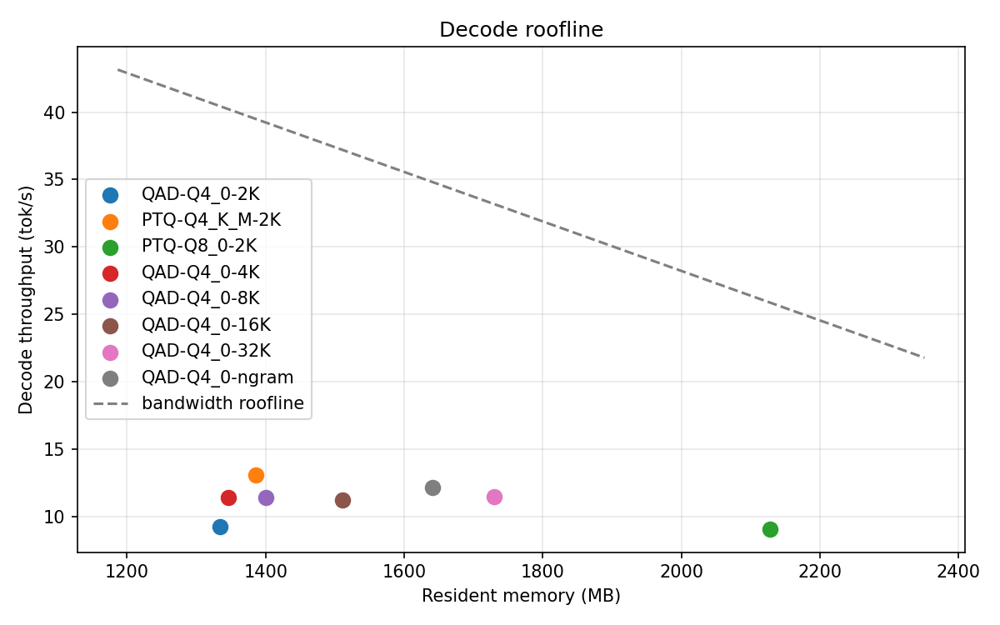

# lfm3-edge-lab

Empirical CPU inference and quantization profiler for **Liquid AI's LFM3-1.7B** tri-hybrid architecture (`13x Gated Short Conv + 5x Sliding-Window GQA + 6x Global GQA`) running on memory-constrained consumer hardware (**11th-Gen Intel Core i3, 8GB RAM**) via `llama.cpp`.

## What This Benchmarks
1. **QAD vs. PTQ on CPU:** Compares Liquid AI's Quantization-Aware Distilled `Q4_0` checkpoint against standard Post-Training Quantized `Q4_K_M` and `Q8_0` across decode throughput (`tok/s`), prefill speed, and peak RSS memory.
2. **Tri-Hybrid KV Cache Scaling:** Measures RAM footprint growth from `2K` to `32K` context tokens, verifying how capping 18/24 layers to fixed ring buffers prevents swap thrashing on an 8GB laptop.
3. **Speculative Lookup Gain:** Evaluates `ngram-simple` / prompt-lookup speculation on structured JSON and tool-calling workloads versus open-ended generation.

## Setup

### 1. Install `llama.cpp` (Windows)
```powershell
winget install --id ggml.llamacpp --exact --source winget
```

### 2. Install Python Dependencies
```powershell
python -m venv .venv
.\.venv\Scripts\Activate.ps1
pip install -r requirements.txt
```

### 3. Download LFM3-1.7B GGUF Checkpoints
```powershell
hf download LiquidAI/LFM3-1.7B-GGUF `
  LFM3-1.7B-QAD-Q4_0.gguf `
  LFM3-1.7B-Q4_K_M.gguf `
  LFM3-1.7B-Q8_0.gguf --local-dir ./models
```

### 4. Run the Benchmark Suite
```powershell
python main.py
```

## Results

Measured on the target i3 / 8GB machine with `llama-server` b12648 (Vulkan build, `-ngl 0`), ChatML chat completions with `enable_thinking: false`. Each row is the median of 3 runs after 1 untimed warmup; IQR is reported per row in [`results/report.md`](results/report.md).

Interactive showcase: [`results/report.html`](results/report.html) · [live report](https://gittanish.github.io/lfm3-edge-lab/results/report.html).

| Config | Decode tok/s (median) | IQR | RSS MB |
| --- | --- | --- | --- |
| QAD Q4_0 2K | 8.9–11.0 | 0.3–0.9 | 1,118–1,326 |
| PTQ Q4_K_M 2K | 9.5–11.3 | 0.7–1.5 | 1,162–1,378 |
| PTQ Q8_0 2K | 6.6–9.4 | 0.2–0.9 | 1,907–2,065 |

- **KV scaling (QAD, JSON workload, 2K→32K):** RSS grows **1,326 → 1,737 MB** (+411 MB for 30K extra context), while decode stays ~9.0–12.0 tok/s.
- **Speculative lookup:** `ngram-simple` reached **49.1% acceptance** on repetitive tool calls, lifting median decode **10.91 → 15.57 tok/s (+43%)**; the earlier single-run pass showed up to **+85%**. JSON output has no long prompt n-gram reuse, so acceptance was 0% and there was no reliable gain.
- **ChatML + `enable_thinking: false`** removed premature EOS and reasoning-token skew; all four workloads now produce usable decode measurements on every quantisation.



Medians suppress within-run noise, but cross-configuration CPU clock state still varies; treat sub-10% differences as noise.
